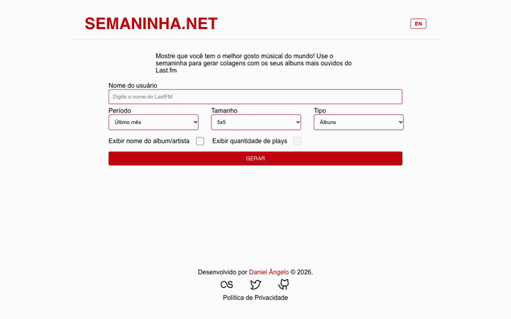

<h1 align="center"> SEMANINHA </h1>

## 📖 Sobre

O Site **Semaninha** é um gerador de colagem dos albuns, artistas ou faixas mais escutados pelo usuário no **Last.fm**.

---

## 🚀 Tecnologias e ferramentas utilizadas

- **React** + **TypeScript**
- **Vite**
- **React Hook Form**
- **React Router**
- **Zod** (validação de env/schemas)
- **i18next** (pt/en)
- **Axios**
- **Phosphor Icons**
- **Vitest** + **Testing Library** + **MSW**
- **Playwright** + **axe** (testes ponta a ponta e acessibilidade)
- **ESLint**
- **Sentry**
- **Vercel** (deploy + funções serverless)

---

## 🖥️ Demonstração



Vídeo em melhor qualidade: [docs/demo.mp4](docs/demo.mp4).

Você pode acessar o projeto clicando [aqui](https://www.semaninha.net/).

---

## 🔧 Como executar o projeto

```bash
# Clone o repositório
git clone https://github.com/danielangelo1/semaninha-lastfm

# Entre no diretório
cd semaninha-lastfm

# Instale as dependências
npm install
```

A chamada à API do Last.fm passa por uma função serverless (`api/lastfm.ts`) pra manter a chave fora do navegador. Crie um arquivo `.env` na raiz (veja [.env.example](.env.example)):

```bash
LASTFM_API_KEY=sua_api_key_do_lastfm
```

Como essa variável só existe no lado do servidor, rodar `vite` sozinho não é suficiente — use a CLI da Vercel:

```bash
npm install -g vercel
vercel dev
```

---

## 🧪 Testes

```bash
# Testes unitários e de integração (Vitest)
npm run test:run

# Testes ponta a ponta (Playwright): gera o build de produção, sobe com
# `vite preview` e testa colagem, Wrapped, navegação, HTML pré-renderizado e
# acessibilidade, no desktop e no celular, com a API do Last.fm simulada.
npx playwright install chromium   # só na primeira vez
npm run test:e2e

# Os mesmos testes no modo interativo
npm run test:e2e:ui

# Smoke contra um site publicado, com o Last.fm de verdade
E2E_BASE_URL=https://www.semaninha.net npm run test:e2e -- --project=desktop
```

No GitHub Actions, o workflow `E2E` roda a suíte completa em todo PR e o smoke em cada deploy da Vercel (preview e produção).

---

**Desenvolvido com 💛 por [Daniel Ângelo](https://github.com/danielangelo1/).**
