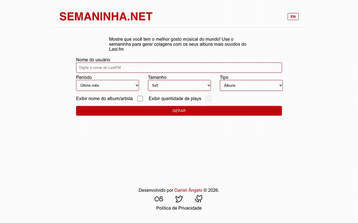

<h1 align="center"> SEMANINHA </h1>

## 📖 Sobre

O Site **Semaninha** é um gerador de colagem dos albuns, artistas ou faixas mais escutados pelo usuário no **Last.fm**.

---

## 🚀 Tecnologias e ferramentas utilizadas

- **React** + **TypeScript**
- **Vite**
- **React Hook Form**
- **React Router**
- **Zod** (validação de env/schemas)
- **i18next** (pt/en)
- **Axios**
- **Phosphor Icons**
- **Vitest** + **Testing Library** + **MSW**
- **ESLint**
- **Sentry**
- **Vercel** (deploy + funções serverless)

---

## 🖥️ Demonstração



Vídeo em melhor qualidade: [docs/demo.mp4](docs/demo.mp4).

Você pode acessar o projeto clicando [aqui](https://www.semaninha.net/).

---

## 🔧 Como executar o projeto

```bash
# Clone o repositório
git clone https://github.com/danielangelo1/semaninha-lastfm

# Entre no diretório
cd semaninha-lastfm

# Instale as dependências
npm install
```

A chamada à API do Last.fm passa por uma função serverless (`api/lastfm.ts`) pra manter a chave fora do navegador. Crie um arquivo `.env` na raiz (veja [.env.example](.env.example)):

```bash
LASTFM_API_KEY=sua_api_key_do_lastfm
```

Como essa variável só existe no lado do servidor, rodar `vite` sozinho não é suficiente — use a CLI da Vercel:

```bash
npm install -g vercel
vercel dev
```

---

**Desenvolvido com 💛 por [Daniel Ângelo](https://github.com/danielangelo1/).**
